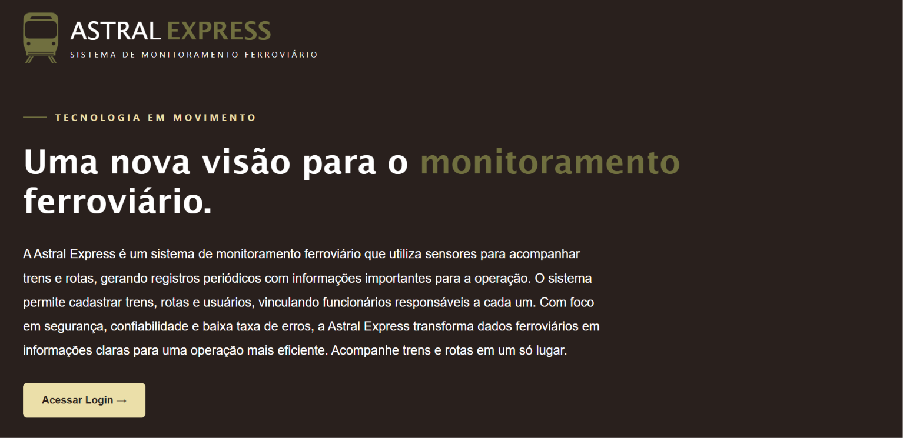
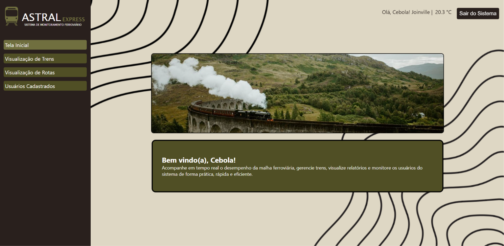

# SA Astral Express

A proposta do sistema é criar um aplicativo que monitore o funcionamento das locomotivas e trilhos, a fim de garantir que não hajam problemas no seu funcionamento, além de permitir o acompanhamento do desempenho do trem, a identificação de falhas e a geração de relatórios analíticos. Com o objetivo de facilitar a identificação de problemas e falhas, além de armazenar, organizar, gerenciar informações de forma mais eficiente e estruturada, evitando que informações se percam ou se repitam, tanto sobre os trilhos quanto nos trens, garantindo que todos os problemas possam ser sanados.

# Metodologias de desenvolvimento que serão utilizadas:
- Scrum
- XP
- Prototipação 
- Kanban

O Scrum será utilizado para organizar o projeto em ciclos curtos e colaborativos, facilitando a resolução de problemas e bugs, tendo reuniões diárias para o alinhamento das ideias da equipe, para garantir que todos saibam o que cada um tem que fazer, o que já foi feio e o que ainda falta fazer. 

O método Kanban será utilizado para esclarecer o que cada membro da equipe deve fazer e o prazo para a resolução de cada tarefa, utilizando o método de separação de tarefas, que separa o quadro em cinco colunas principais: Backlog, Ready, In progress, In review e Done. 

A Prototipação será utilizada para criar um modelo visual do site pronto, facilitando na hora de fazer programar, pois já teremos um modelo correto a seguir. 

O método XP será utilizado para verificação e análise de 2 grupos de 2 integrantes cada da equipe, assim mantendo a eficiência enquanto um faz, outro testa, vice versa.

##  Funcionalidades
O sistema irá cadastrar todos os funcionários que utilizarão o sistema, permitirá o cadastro de trens, rotas e sensores. Ele também irá permitir visualizar a lista de sensores e os relatórios criados, juntamente com os detalhes de cada sensor, como ID do sensor, localização e tipo de dado monitorado. Também haverá a exibição da velocidade, localização e status operacional ao usuário. Além  de permitir a exclusão de sensores caso ainda não haja dados vinculados a ele.  

## Regras de Negócio: 

- | RN1 | Toda informação dentro do sistema deve ir para o banco de dados 

- | RN2 | É possível fazer login na tela de autenticação 

- | RN3 | As credenciais são autenticadas no banco de dados 

- | RN4 | Se as credenciais autenticadas estiverem no banco de dados, cria-se uma sessão 

- | RN5 | Quando uma sessão de autenticação no banco de dados for criada, o usuário é redirecionado até a tela principal do ADM 

- | RN6 | O nome do administrador autenticado deve ser exibido na tela principal  

- | RN7 | Na tela principal deve ter um botão para sair do sistema 

- | RN8 | Na tela principal deve ter um botão para acessar os cadastros de trens 

- | RN9 | A velocidade, localização e status operacional é exibido ao usuário 

## Requisitos Funcionais:

- | RF1 | O sistema deve permitir que o login seja realizado.

- | RF2 | O sistema deve permitir o usuário cadastrar, atualizar, excluir, visualizar um trem

- | RF3 | O sistema deve permitir o usuário cadastrar rota de trem

- | RF4 | O sistema deve criar uma sessão se a credencial for autenticada

- | RF5 | O sistema deve exibir o nome do administrador autenticado

- | RF6 | O sistema deve permitir fazer logout, encerrando a sessão

## Requisitos não funcionais

- | RNF1 | O sistema deve garantir autenticação de usuários por meio de login e senha.

- | RNF2 | O sistema deve registrar logs de acesso e ações dos usuários. 

- | RNF3 | O sistema deve responder às requisições em até 2 segundos. 

- | RNF4 | O sistema deve suportar no mínimo 100 usuários simultaneamente sem perda de desempenho.

- | RNF5 | O sistema deve atualizar os dados em tempo real ou quase real.

- | RNF6 | O sistema deve permitir expansão para suportar aumento de usuários.

- | RNF7 | O sistema deve suportar crescimento no volume de dados monitorados.

- | RNF8 | O sistema deve estar disponível 24 horas por dia, 7 dias por semana. 

- | RNF9 | O sistema deve possuir código organizado e documentado. 

- | RNF10 | O sistema deve permitir a adição de novas funcionalidades sem comprometer o funcionamento atual. 

- | RNF11 | O sistema deve possuir interface intuitiva e de fácil utilização. 

- | RNF12 | O sistema deve apresentar informações de forma clara e organizada. 

- | RNF13 | O sistema deve ser responsivo, adaptando-se a diferentes dispositivos (desktop e celular).

- | RNF14 | O sistema deve garantir que os dados não sejam perdidos ou corrompidos. 

- | RNF15 | O sistema deve redirecionar o usuário até a tela do administrador se uma sessão for criada.

- | RNF16 | O sistema deve retornar o usuário para a tela de login se a credencial não for autenticada.

- | RNF17 | O sistema deve ter um botão “sair do sistema”.

- | RNF18 | O sistema deve armazenar as senhas dos usuários utilizando um mecanismo seguro de hash.

- | RNF19 | O sistema deve conter proteção contra SQL injection.

- | RNF20 | O sistema deve realizar consultas parametrizadas nas operações com o banco de dados.

- | RNF21 | O sistema deve pelos formulários validar os dados recebidos no backend antes de realizar as operações no banco de dados.

- | RNF22 | O sistema deve impedir que usuários vejam dados que não estejam no nível de acesso.

- | RNF23 | O sistema deve impedir que usuários que não possuem permissão atribuam a si o perfil de administrador por dados enviados pelo frontend. 

- | RNF24 | O sistema deve evitar exposição desnecessária de dados sensíveis no frontend.

- | RNF25 | O sistema deve tratar erros durante as operações do backend sem mostrar informações internas da aplicação.

# Tecnologias utilizadas 

- HTML: Estruturação das páginas.

- CSS: Estilização e organização visual.

- JavaScript: Interatividade e manipulação de elementos.

- PHP: Processamento das requisições e regras de negócio.

- MySQL: Armazenamento e gerenciamento dos dados.

- XAMPP: Ambiente de desenvolvimento local.

- Git e GitHub: Versionamento e colaboração.

- APIs: Integração de funcionalidades(especificadas ao final do documento).

# APIs utilizadas

## API de CEP: 
A API de CEP que foi escolhida é a API ViaCEP. Ela foi escolhida por ser a mais usada no Brasil. Gratuito, sem cadastro, sem autenticação. Foi por muito tempo a opção padrão para projetos pequenos e médios, e ainda é relevante pela simplicidade de integração. 
A ViaCEP é um serviço web baseado em HTTP/REST. Isso significa que qualquer linguagem de programação ou ferramenta que consiga fazer uma requisição HTTP pode usá-la.

## Pontos positivos: 
- Gratuito sem cadastro
- Latência média de 80ms
- Suporta busca reversa (por endereço, retorna CEPs)

## Pontos Negativos: 
- Sem SLA oficial, sem suporte
- Uso comercial intensivo é desencorajado

## API: 
https://viacep.com.br/

## Fontes: 
- https://blog.hubdodesenvolvedor.com.br/melhores-apis-cep-comparativo-2026/
- https://viacep.com.br/

 ## API de Clima

A API de clima escolhida é a Open-Meteo. Ela foi escolhida por ser gratuita para uso não comercial, não exigir cadastro nem chave de autenticação e permitir a consulta de informações meteorológicas.

A Open-Meteo é um serviço web que utiliza requisições HTTP e retorna dados em formato JSON, permitindo sua integração com JavaScript, PHP e outras linguagens de programação.

## Pontos positivos

- Gratuita para uso não comercial.
- Não exige cadastro nem chave de API.
- Fornece temperatura, umidade, vento e previsão do tempo.
- Retorna dados em JSON, facilitando a integração com JavaScript e PHP.

## Pontos negativos

- Possui limites de requisições para uso gratuito.
- Não garante disponibilidade contínua nem precisão absoluta dos dados.
- Exige atribuição à Open-Meteo ao exibir os dados.

## API

https://open-meteo.com/

## Fontes

- https://open-meteo.com/
- https://open-meteo.com/en/docs
- https://open-meteo.com/en/terms

# Requisitos para execução do sistema

- Ambiente de desenvolvimento vitual(preferencialmente XAMPP): Rodar o sistema.

- Visual Studio Code: Caso queira realizar alterações no código.

- Git e GitHub: Versionar o sistema e buscar a base dele.

- Navegador: Executar o sistema.

# Instalação e configuração 

1- Instalar o XAMPP.

2- Baixar ou clonar o repositório do GitHub.

3- Localizar a pasta de instalação do XAMPP.

4- Colocar a pasta do projeto dentro de HTdocs.

5- Abrir o painel de controle do XAMPP.

6- Iniciar os serviços Apache e MySQL.

7- Configurar a conexão com o banco de dados.

8- Executar o banco de dados dentro do PHPMyAdmin.

9- Pronto para o uso.

# Como iniciar a aplicação 

1- Iniciar o Apache e MySQL pelo XAMPP.

2- Abrir o navegador.

3- Digitar o endereço local do projeto.
**Importante lembrar de colocar o arquivo do código dentro da pasta HTdocs**

4- Pronto para o uso.

# Perfis com acesso e permissões

As permissões de visualização de todo e qualquer Trem, Rota e Usuário é concedido a qualquer um que seja funcionário. Já a permissão de exclusão, atualização e cadastro é definida apenas para Administradores.

# Estrutura geral do projeto

Ferrorama Astral Express:.
│   .gitignore
│   index.php
│   LICENSE
│   README.md
│   
├───assets
│   ├───img
│   │       3_pontos.png
│   │       banner_trem.jpg
│   │       botao_excluir.png
│   │       cadastro_relatorios.png
│   │       cadastro_sensores.png
│   │       calendario_branco.png
│   │       calendario_preto.png
│   │       consumo_medio.png
│   │       estacao.png
│   │       estacao_2.png
│   │       falha.png
│   │       filtro.png
│   │       fundo.png
│   │       landing_page_nova.png
│   │       landing_page_velha.png
│   │       mapa_trilho.png
│   │       mecanica.png
│   │       monitoramento_tempo.png
│   │       pesquisa_PDO.png
│   │       recarregar.png
│   │       sair.png
│   │       tela_inicial.png
│   │       tela_inicial_antiga.jpg
│   │       tela_inicial_nova.png
│   │       temperatura.png
│   │       trem.PNG
│   │       trem_boas_vindas.png
│   │       trem_botao.png
│   │       usuario.png
│   │       usuarios.png
│   │       velocidade.png
│   │       
│   └───style
│           style.css
│           
├───database
│       db.sql
│       
├───doc
│   │   relatorio-uso-ia.md
│   │   SCRUM.md
│   │   XAMPP.md
│   │   
│   ├───crud
│   │       php.md
│   │       
│   └───pesquisas
│           apis.md
│           identidade_visual.md
│           image.png
│           pdo.md
│           
├───infra
│       conexao.php
│       
├───public
│       cadastrar_rota.php
│       cadastrar_trem.php
│       cadastrar_usuarios.php
│       cadastro_rotas.php
│       cadastro_trens.php
│       cadastro_usuarios.php
│       certeza_excluir_rota.php
│       certeza_excluir_trem.php
│       certeza_excluir_usuario.php
│       editar_rota.php
│       editar_trens.php
│       editar_usuario.php
│       excluir_rota.php
│       excluir_trens.php
│       excluir_usuario.php
│       formulario_editar_rota.php
│       formulario_editar_trem.php
│       formulario_editar_usuario.php
│       login.php
│       logout.php
│       tela_inicial.php
│       tela_login.php
│       usuarios_cadastrados.php
│       visualizacao_rotas.php
│       visualizacao_trens.php
│       
└───scripts
        script.js

# Imagens de telas da versão final

# Integrantes e suas contribuições

- Henrique Incerti
- Serenna Tavares
- Thaís Duarte
- Natan Vitor
- Contribuição de Annie Marrie