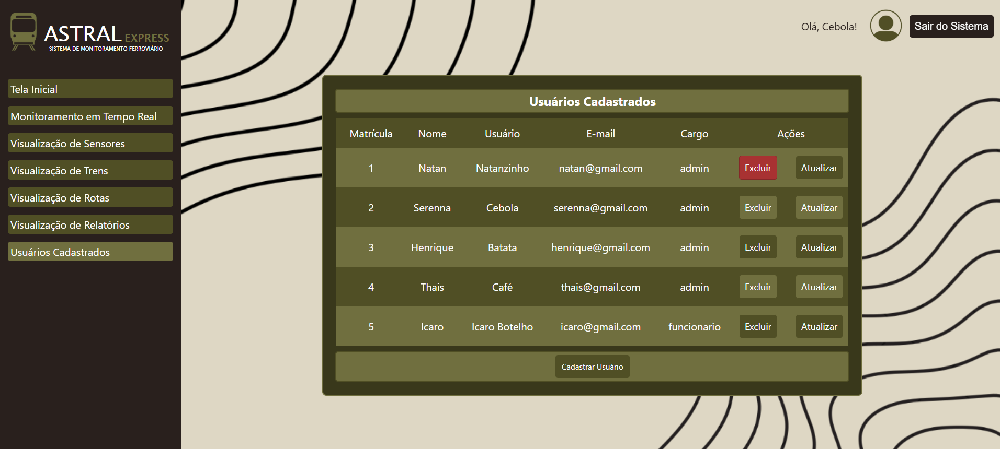
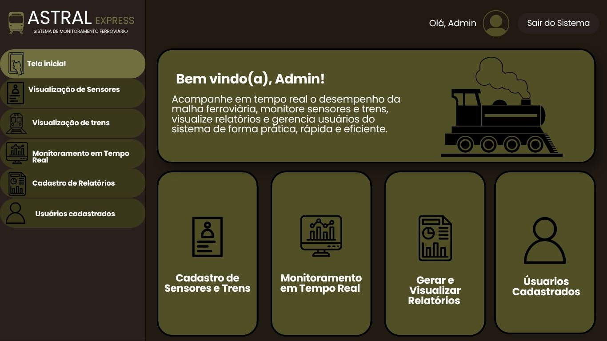
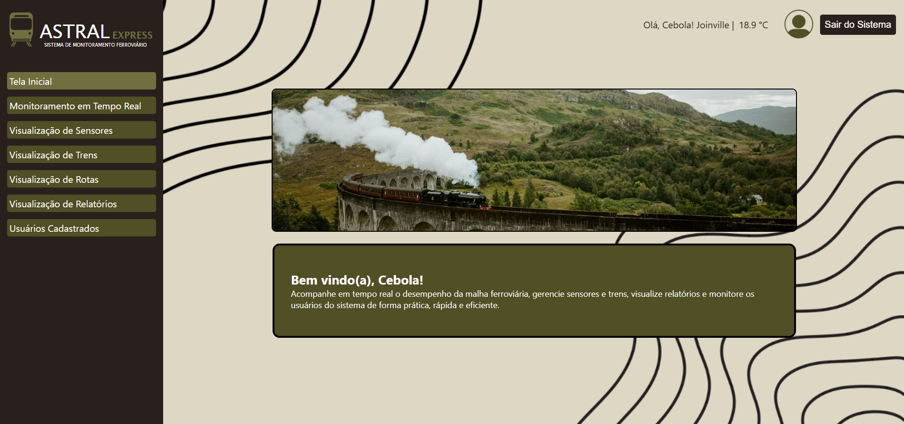
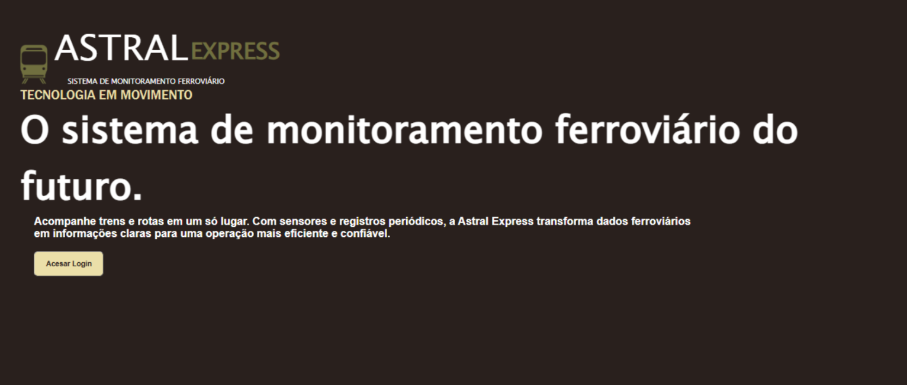
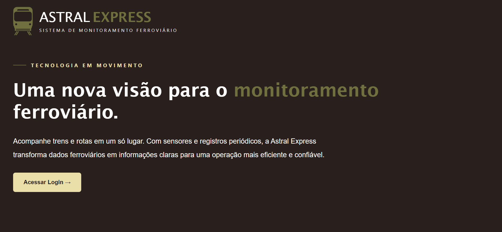

# Identidade Visual e Psicologia das Cores

As cores fazem parte da vida das pessoas e, segundo a psicologia, têm o poder de despertar sentimentos, emoções e ações.

De acordo com um estudo da Universidade de Winnipeg, quando um usuário acessa um site, ele baseia parte da decisão de continuar ou sair da página nas cores. É possível, por exemplo, despertar a atenção de um consumidor a partir de uma composição bem feita de cores ou gerar o efeito oposto ao desejado, caso elas não sejam bem utilizadas.

Atualmente, a psicologia das cores é utilizada por marcas e designers para comunicar mensagens por meio da escolha de cores para logos e marcas.

A identidade visual e a coerência na escolha das cores são partes essenciais na criação de um site atrativo e funcional. Nossas escolhas de cores e a identidade visual do site como um todo foram feitas para tornar a experiência do usuário o mais agradável e intuitiva possível.

Utilizamos tons de verde, pois muitas pessoas associam as viagens de trem à natureza e à tranquilidade. Além disso, o verde representa renovação, equilíbrio e harmonia, sendo também associado à segurança, algo que qualquer empresa de transporte busca transmitir aos seus possíveis passageiros. Mantivemos o site objetivo, prático e funcional.

Também utilizamos um recurso que muda a cor dos botões quando o cursor do mouse passa por cima, visando melhorar a usabilidade e facilitar a utilização do sistema. Nos botões de exclusão a cor muda de verde para vermelho, chamando mais a atenção do usuário durante a operação e deixando mais claro o risco daquela ação.

Optamos por utilizar a imagem de um trem em nossa logo, pois ela transmite bem o objetivo e a identidade da nossa empresa no ramo ferroviário. Também colocamos fotos de trens, ferrovias e paisagens no site a fim de torná-lo mais atrativo para os usuários.

# Modificações no Visual do Site

Nosso site passou por algumas modificações em relação ao design, desde o mockup até a versão final, a fim de garantir que ficasse esteticamente coerente e funcional, proporcionando uma boa experiência de utilização ao usuário.

Uma das maiores mudanças aconteceu na tela inicial, onde retiramos os botões de atalho e optamos por deixar tudo no menu lateral do site, tornando-o mais direto e claro. Também acrescentamos a imagem de uma ferrovia para que a tela ficasse mais bonita.

No menu lateral optamos por deixar seus botões um pouco menores e sem os ícones, a fim de torná-lo mais sério e formal.

Por fim, também mudamos o fundo, deixando o site mais claro sem perder a identidade.

# Desenvolvimento e Atualização da Landing Page

Durante o desenvolvimento, foi solicitada a criação de uma landing page para o site. Inicialmente foi elaborada uma ideia utilizando o background padrão das outras páginas e letras com cores opostas ao fundo, para facilitar a leitura. A página apresenta uma breve descrição do sistema e possui um botão que direciona o usuário para o login.

Em relação à nomenclatura, os elementos foram nomeados de acordo com suas funções e com a página a que pertencem, facilitando a compreensão e a identificação de suas funcionalidades.

Durante o desenvolvimento da landing page, não houve problemas na criação do código. A principal alteração planejada foi na parte visual, com o intuito de melhorar sua apresentação.

Após a criação do conceito inicial, foi feita uma atualização no visual da página. Foram alterados os tamanhos dos textos, dividindo melhor o título, a descrição e o botão, que também teve seu tamanho aumentado. No título, o texto foi modificado e uma das palavras, que antes era branca, passou a ser verde. O texto localizado acima do título foi diminuído e também foi acrescentada uma linha lateral antes dele.

Outro detalhe importante dessa modificação foi o espaçamento entre os textos, o botão e a logo, pensado para melhorar a visualização de cada elemento.

**Fonte:** https://www.meioemensagem.com.br/marketing/psicologia-das-cores
https://docs.google.com/document/d/1qOURhdCoCC7MXLMNn2jk1HQUC_7NA3AgWLra04B5QCk/edit?tab=t.0
